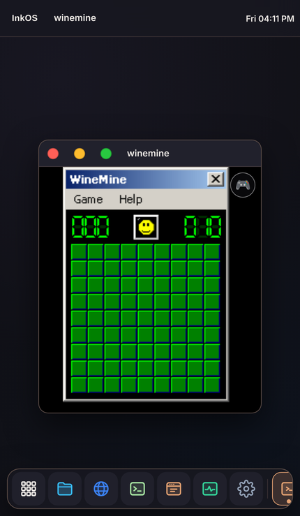
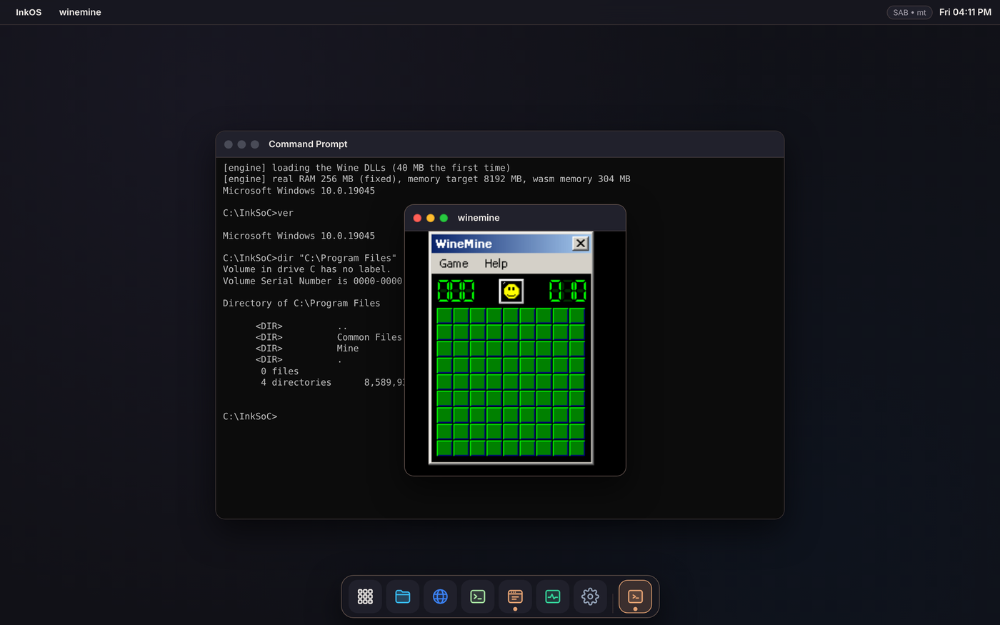

<p align="center"></p>

<p align="center"><b>The engine that runs Windows programs in InkOS, on iPad, iPhone and PC: our own x86-64 engine (JIT, WebAssembly) with Wine.</b></p>

<p align="center"><b><a href="https://inkos-5k7.pages.dev/?open=cmdexe">Open in InkOS</a></b> · part of <a href="https://github.com/InkDOSHub/inkdoshub.github.io">InkDOS Hub</a> · MIT license (Wine: LGPL)</p>

<p align="center"> </p>

# InkSoC

Our own engine to run Windows `.exe` files in the browser, WebKit first (iPhone/iPad).
A Rust engine compiled to WebAssembly runs the x86-64 (and 32-bit, WoW64) code and plays
the part of the kernel that Wine runs on: Wine's DLLs (in `bin/`) are the rest of Windows.

Addresses: https://hub.inkdos.workers.dev/InkSoC/ (multi-core) and https://inkdoshub.github.io/InkSoC/.
Until 2026-11-14 it lived in the Hub repository as `apps/inksoc/`.

## Repository layout

| Path | What |
|---|---|
| `index.html`, `engine.js` | The engine page: no desktop of its own. InkOS shows it in a window; the program's screen fills it (zoomed to its windows), a console program shows as text. `?run=C:\path.exe` runs a program on drive C:, `?file=1` waits for a file from InkOS, nothing opens Command Prompt (cmd.exe) |
| `worker.js` | Core 0: loads the engine, runs the program, owns the screen and files |
| `core.js`, `sharedmem.js`, `swapio.js` | Extra cores on shared memory, and the swap file worker |
| `gl.js`, `gl-funcs.js` | OpenGL on WebGL 2 (`gl-funcs.js` is generated: do not edit) |
| `pad.js`, `prefs.js`, `unzip.js` | On-screen gamepad (the controller button on touch screens), saved settings, .zip install onto drive C: |
| `inksoc.wasm`, `inksoc-mt.wasm`, `wine.wasm` | Built engine (single and multi-core) and Wine's msvcrt |
| `bin/` | Wine DLLs (`wine/` 64-bit, `wine32/` 32-bit), `system32/` tools such as `cmd.exe`, 7-Zip, BusyBox |
| `test.exe`, `stage*.exe`, `testdll.dll` | Small test programs (sources in `src/test*`); run them from Command Prompt |
| `src/engine/` | The engine (Rust). Map of the code: `src/engine/src/graphify-out/` |
| `src/wine/` | Build of Wine's msvcrt for the engine |
| `compat/` | Compatibility runner: real programs from `list.json`, results in `results.json` |
| `tests/apps/` | Runs a real installer or game on GitHub Actions (`request.json`, `run.py`) |
| `tests/arm/` | ARM speed benchmark run on GitHub Actions |
| `linux.html` | Redirect: the Linux terminal is now [InkShell](https://github.com/InkDOSHub/InkShell) |

## Engine (`src/engine/src`)

The Windows code is organized by area, like Wine: one Rust function per Windows API, with its name.

- CPU: `cpu.rs` (interpreter), `sse.rs`, `x87.rs` + `f80.rs` (exact 80-bit FPU), `jit.rs`.
- Memory and processes: `mmu.rs` (64-bit page table, fixed pool of real RAM, swap to OPFS),
  `heap.rs`, `pe.rs` (PE loader), `proc.rs` (child processes), `wow64.rs` (32-bit programs),
  `sched.rs` (threads), `lock.rs` (engine lock with several cores).
- Wine's Unix side: `ntsys/` (NT system calls), `winsys/` (NtUser*), `wingdi/` (NtGdi*),
  `opengl/`, `audio.rs`, `net.rs` (sockets), `registry.rs`, `npipe.rs`, `unixlib.rs`.
- Windows API written here: `kernel32.rs`, `msvcrt.rs`, `oleaut.rs`, `winapi/`, `eh.rs` (C++ exceptions),
  `hash.rs`; anything else falls through to Wine (`winefb.rs`).
- Files: `files.rs`, `store.rs` (drive C:, kept in the browser).
- `linux.rs`: Linux system calls, used by InkShell (which keeps its own patch on top of this engine).

More detail on a few parts:

- `src/engine/src/jit.rs`: JIT. Hot x86-64 blocks (40 visits) become small wasm
  modules that the page compiles and adds to the engine's function table.
  Registers live in wasm locals, flags are lazy (a cmp + jcc becomes one wasm
  compare), a jump back to the block start is a wasm loop, and memory uses the
  same software TLB inline. Instructions it does not translate run through the
  interpreter one at a time. The "JIT" box on the page turns it off.
- `src/wine/`: Wine's msvcrt (string functions, printf, ctype; Wine 10.0, LGPL)
  compiled to `wine.wasm`. The C files are compiled as x86-64 Windows code (so
  structs and `va_list` match the program exactly), retargeted to wasm64, and every
  load/store is routed through the engine's page table (`wasm-opt
  --instrument-memory`, then `--memory64-lowering`). Program pointers are used as
  is, even when their page is in swap. `glue.c` gives it a fixed "C" locale and
  the entry point `ink_call`. Wine's own data and stack sit at 1-4 MB of the
  engine's memory (the engine is linked with `--global-base=4194304`).
- `src/engine/src/sched.rs`: program threads. Each thread is a saved CPU state;
  the engine switches every 200,000 instructions or when a thread waits
  (WaitFor*, Sleep, critical sections, SRW locks, events, mutexes, semaphores).
  When every thread waits on a timeout, `run` returns 3 and the page waits.

## Build

```
cd src/engine && cargo build --release --target wasm32-unknown-unknown && cp target/wasm32-unknown-unknown/release/inksoc.wasm ../../
src/wine/build.sh   # needs clang/llc/wasm-ld 18, binaryen, git (fetches Wine 10.0)
cd src/test64 && x86_64-w64-mingw32-gcc -O2 -D__USE_MINGW_ANSI_STDIO=0 -nostartfiles -fno-builtin -fno-stack-protector -mno-stack-arg-probe -fno-asynchronous-unwind-tables -e start -Wl,--no-insert-timestamp -o ../../stage2.exe stage2.c -lmingw32 -lmsvcrt -lkernel32
cd ../test && x86_64-w64-mingw32-gcc -O2 -nostdlib -ffreestanding -fno-builtin -fno-stack-protector -mgeneral-regs-only -mno-stack-arg-probe -fno-asynchronous-unwind-tables -e start -Wl,--no-insert-timestamp -o ../../test.exe test.c -lkernel32 -lntdll
```

Own programs: build with `-D__USE_MINGW_ANSI_STDIO=0` so printf comes from msvcrt.dll
(mingw's own printf uses x87 instructions, not supported yet).

`worker.js` patches `test_mb` at 0x140002000 (check with `x86_64-w64-mingw32-nm test.exe`).

## Tests

Tests run on GitHub Actions, not on a local machine: `inksoc-apps.yml` (real programs,
`tests/apps/request.json`) and `inksoc-arm-bench.yml`. The Diagnostics window left with the desktop
(2026-11-20); the engine page is checked by InkOS's end-to-end tests.

## Part of InkDOS Hub

Other InkDOS Hub repositories: [Hub](https://github.com/InkDOSHub/inkdoshub.github.io) · [InkSoC](https://github.com/InkDOSHub/InkSoC) · [InkShell](https://github.com/InkDOSHub/InkShell) · [InkCam](https://github.com/InkDOSHub/InkCam) · [InkMind](https://github.com/InkDOSHub/InkMind) · [InkArcade](https://github.com/InkDOSHub/InkArcade) · [InkBench](https://github.com/InkDOSHub/InkBench)

## License

Code made here (engine, page, tools): [MIT](LICENSE). Third party: Wine builds in `bin/wine*` (LGPL-2.1, see their READMEs), 7-Zip `7za.exe` (`bin/7za-license.txt`), BusyBox (GPL-2.0).
